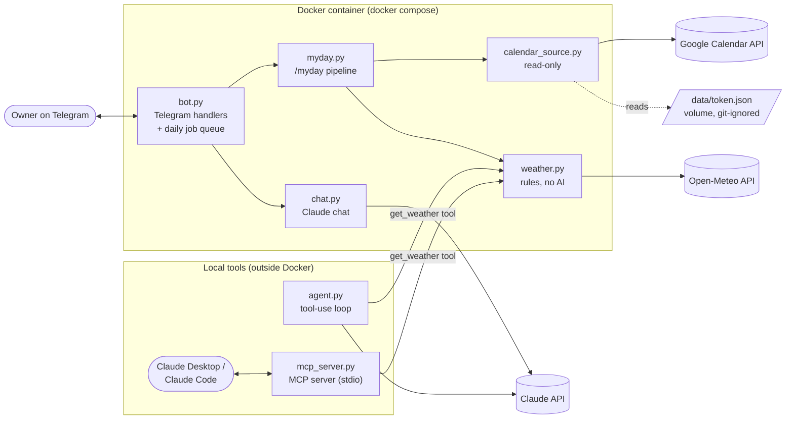

# myday-agent

[](https://github.com/kaamesh143/myday-agent/actions/workflows/ci.yml)
[](LICENSE)

A self-hosted personal AI assistant on Telegram, built with the Claude API, Google Calendar,
Open-Meteo and the Model Context Protocol (MCP). It runs in Docker, replies only to its owner,
and is built in the open as a hands-on AI engineering project with tests, CI and secret scanning
from day one.

## What it does today

| Feature | How it works |
|---|---|
| **`/myday` briefing** | On request and every morning (default 07:00), sends today's meetings from Google Calendar and a weather summary with what to wear. Office calendars can be marked private and show only "Busy". |
| **Chat with Claude** | Any text message is answered by Claude (Haiku). Each reply logs token counts and cost, never the message text. |
| **Agent loop with tools** | `app/agent.py` is a hand-written tool-use loop: Claude asks for a tool, our code runs it and sends the result back, with a step limit and error handling. Tried from the command line today; wiring it into chat is next on the roadmap. |
| **MCP server** | The same weather tool is offered as an MCP server over stdio, so Claude Desktop, Claude Code or any MCP client can use it. See [docs/mcp.md](docs/mcp.md). |
| **Owner-only access** | The bot answers only Telegram user IDs in `ALLOWED_USER_IDS`. Everyone else is ignored and logged. |

## Architecture



**Design choices**

- `/myday` is a **fixed pipeline**, not an agent: the steps are always the same, so plain code is
  cheaper, faster and easier to test than letting a model decide.
- The agent and the MCP server **share one tool definition**, so their descriptions cannot drift apart.
- Tool results are treated as **data, never instructions** (prompt-injection defence in the system prompt).
- Every external call has a timeout, a retry where it makes sense, and a friendly fallback message.

## Quick start (Docker)

Prerequisites: Docker with Compose, a Telegram account, an Anthropic API key.

1. In Telegram, open **@BotFather**, send `/newbot` and copy the token.
2. Create your settings file and fill in `TELEGRAM_BOT_TOKEN` and `ANTHROPIC_API_KEY`:
   ```bash
   cp .env.example .env
   ```
3. Start the bot and find your Telegram user ID:
   ```bash
   docker compose up --build
   ```
   Message the bot. It will not reply; the log shows
   `Ignored message from unauthorized user id=...`.
4. Put that ID in `ALLOWED_USER_IDS` in `.env`, then run it in the background:
   ```bash
   docker compose up --build -d
   ```
5. In Telegram, send `/help`, `/myday` or any question.

**Optional: Google Calendar.** Follow [docs/google-setup.md](docs/google-setup.md). The one-time
sign-in (`python -m app.google_auth`) runs on your own computer and saves a read-only token to
`data/token.json`, which is mounted into the container and never committed.

**Optional: MCP server.** See [docs/mcp.md](docs/mcp.md) to connect the weather tool to Claude
Desktop or Claude Code, or run `python -m app.try_mcp` to see discovery and a tool call.

## Development

```bash
python3 -m venv .venv && source .venv/bin/activate
pip install -r requirements-dev.txt
pre-commit install        # gitleaks + ruff on every commit
ruff check . && ruff format --check . && pytest -q
```

Tests use synthetic data and mocked APIs only, so they run without any keys.

**CI** ([.github/workflows/ci.yml](.github/workflows/ci.yml)) runs on every push and pull request:

| Job | What it checks |
|---|---|
| `test` | `ruff` lint and format check, then `pytest` |
| `secrets` | gitleaks scan of the full git history |
| `docker` | the image builds |

Dependabot keeps dependencies up to date.

## Project layout

```
app/
  bot.py              Telegram entry point, handlers, daily schedule
  chat.py             Claude chat with input limits and friendly errors
  claude_client.py    one Claude request, token counts and cost estimate
  agent.py            tool-use agent loop and the weather tool
  mcp_server.py       weather tool as an MCP server (stdio)
  myday.py            /myday pipeline: calendar + weather
  calendar_source.py  Google Calendar, read-only, private calendars as "Busy"
  weather.py          Open-Meteo forecast turned into two plain lines
  google_auth.py      one-time Google sign-in
  config.py           settings from environment variables
  try_*.py            small manual scripts to try each part
tests/                pytest suite (synthetic fixtures, no network)
docs/                 project plan, ADRs, MCP and Google setup, learning notes
```

## Skills shown

| Area | Where to look |
|---|---|
| **LLM integration (Claude API)** | Messages API, system prompts, stop reasons (`refusal`, `max_tokens`), token and cost tracking: `app/claude_client.py`, `app/chat.py` |
| **AI agents and tool use** | Hand-written agent loop with step limits, several tool calls per round and safe error handling: `app/agent.py` |
| **Model Context Protocol** | MCP server with tool annotations and stdio transport: `app/mcp_server.py`, `docs/mcp.md` |
| **API integration** | Google Calendar (OAuth, read-only scope, token refresh) and Open-Meteo (timeouts, retry): `app/calendar_source.py`, `app/weather.py` |
| **Containers** | Slim Python image, non-root user, Compose with a data volume for secrets: `Dockerfile`, `docker-compose.yml` |
| **CI/CD** | GitHub Actions for lint, tests, secret scanning and image build; Dependabot: `.github/` |
| **Security by default** | Owner-only allowlist, least-privilege scopes, no secrets or message text in logs, gitleaks in pre-commit and CI, prompt-injection guard: `SECURITY.md`, `AGENTS.md` |
| **Testing** | 100+ pytest tests with mocked APIs and synthetic fixtures: `tests/` |
| **Engineering practice** | Architecture decision records, project plan, learning notes: `docs/` |

## Roadmap

Next up, from the [project plan](docs/PROJECT_PLAN.md): agent tools in Telegram chat, a Gmail
ticket agent (read-only), RAG over email history, an evaluation harness in CI, and a deploy
pipeline with OpenTelemetry tracing.

## Security

- Replies only to Telegram IDs in `ALLOWED_USER_IDS`.
- Google access is **read-only**.
- No personal data in this repo: tests use synthetic data only.
- Secrets live in `.env` and `data/` (both git-ignored). gitleaks runs locally and in CI.
- Found a vulnerability? See [SECURITY.md](SECURITY.md).

## License

[MIT](LICENSE)
